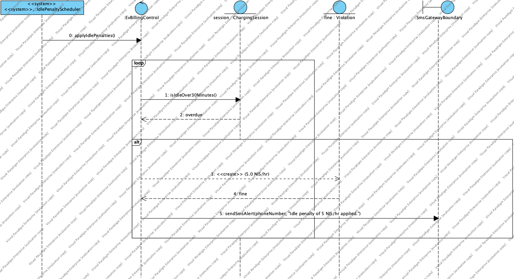

# Architecture – Smart Campus Parking, LPR, and EV Network

**Course:** 61756 Software Engineering Methods  
**Exercise:** 4 – UML Activity, ECB Class and Sequence Diagrams

## 1. Team Members and GitHub URL

| Full Name | Student ID | Email |
|---|---|---|
| [Nofar Anger] | [324848969] | [nofar.bulgaru@e.braude.ac.il] |
| [Ofir Haviv] | [326397668] | [ofir.haviv@e.braude.ac.il]|

**GitHub URL:** [https://github.com/nofar1352/Ex4_SmartParking_Design]

---

## 2. UML Diagrams

### 2.1 Security Enforcement and Digital Appeals – Activity Diagram

### 2.2 ECB Class Diagram

### 2.3 Spot Reservation, LPR Gate Entry and No-Show Destruction – Sequence Diagram

### 2.4 EV Charging 30-Minute Idle Penalty – Sequence Diagram

---

## 3. ECB Component Responsibility Table

### Architecture Overview

The system uses the Entity-Control-Boundary (ECB) architectural pattern to separate user interfaces, external system interfaces, business logic, and domain data.

The architecture supports automated gate entry, parking reservations, EV charging and billing, security enforcement, and digital appeals.

### Component Responsibilities

| ECB Type | Component | Responsibility |
|---|---|---|
| Boundary | StudentDashboardUI | Displays available parking spots, reservation countdowns, and error messages. Handles reservation and appeal requests. |
| Boundary | GuardTerminalUI | Handles severe violation reports and guest QR pass requests. |
| Boundary | AdminAppealUI | Allows the traffic administrator to review appeals and submit decisions. |
| Boundary | LprGateBoundary | Receives license plate and QR scans and controls gate entry. |
| Boundary | PaymentGatewayBoundary | Requests credit card payment authorization. |
| Boundary | SmsGatewayBoundary | Sends SMS notifications to users. |
| Control | ReservationControl | Manages zone filtering, parking reservations, gate entry, and reservation expiration. |
| Control | EvBillingControl | Manages EV payment authorization, charging completion notifications, and idle penalties. |
| Control | EnforcementControl | Manages guest passes, severe violations, fines, and digital appeals. |
| Entity | User | Stores common user information, roles, and no-show warnings. |
| Entity | Student | Represents students and their active parking permits. |
| Entity | Faculty | Represents faculty members, departments, and active parking permits. |
| Entity | SecurityGuard | Represents campus security guards and their badge numbers. |
| Entity | TrafficAdministrator | Represents administrators responsible for reviewing appeals. |
| Entity | GuestPass | Stores temporary guest QR tokens, expiration times, and usage status. |
| Entity | Vehicle | Represents vehicles through their license plates. |
| Entity | ParkingZone | Represents parking zones and their capacity. |
| Entity | ParkingSpot | Stores parking spot status, EV charger availability, and version-based concurrency information. |
| Entity | Reservation | Represents parking reservations, expiration times, and reservation status. |
| Entity | PaymentAuthorization | Stores credit card payment authorization information. |
| Entity | ChargingSession | Stores charging completion time, electrical connection state, physical occupancy, and idle penalties. |
| Entity | Violation | Represents parking violations and associated fines. |
| Entity | Appeal | Stores digital appeal reasons and appeal decisions. |

### Domain Relationships

- User is the abstract superclass of Student, Faculty, SecurityGuard, and TrafficAdministrator.
- ParkingZone aggregates one or more ParkingSpot objects.
- User owns zero or more Vehicle objects.
- Vehicle can be associated with multiple Reservation and Violation objects.
- Each Reservation is assigned to one ParkingSpot.
- Reservation may contain one PaymentAuthorization and one ChargingSession through composition.
- Violation may contain one Appeal through composition.
- SecurityGuard logs violations and issues guest passes.
- TrafficAdministrator reviews digital appeals.
- Boundary classes communicate with Control classes.
- Control classes manage the relevant Entity classes.

### Core Workflows

#### Reservation and Gate Entry

Students may view and reserve parking spots only in the Student Zone, while faculty members may reserve spots across all zones.

Reservations are valid for a maximum of 15 minutes. The ReservationControl checks parking spot availability and attempts to acquire the spot before creating a reservation.

Registered users require an active parking permit for automatic gate entry. Unregistered guests require a valid temporary QR pass.

A no-show must trigger automatic reservation revocation, termination of the active reservation instance, and an increment of the user's noShowWarnings counter.

#### EV Charging and Idle Penalties

EV charging requires credit card payment authorization.

When charging reaches 100%, the system sends an SMS notification to the user.

If the vehicle remains physically parked in the EV bay after the 30-minute grace period following the notification, the system applies an idle penalty of 5 NIS per hour until the vehicle physically leaves the parking spot.

#### Security Enforcement and Digital Appeals

Security guards patrol campus parking lots and report severe parking violations.

EnforcementControl attaches the fine to the vehicle owner's account and dispatches a violation notification in parallel.

An unresolved fine blocks annual parking permit renewal.

Users may submit digital appeals through StudentDashboardUI. The TrafficAdministrator reviews each appeal and either approves it, canceling the fine, or rejects it, enforcing the fine.

---

## 4. Part 4 – Verbatim AI Critique Prompt & Applied Improvements

### 4.1 Verbatim AI Critique Prompt

Review my UML Activity, Class (ECB), and Sequence Diagrams against the two edge cases described in Section 3 of SYSTEM_STORY.md.

**Edge Case A – Double-Booking Race Condition:**

Two students attempt to reserve the last available parking spot in the Student Zone at exactly the same millisecond. Verify that the diagrams correctly use the version attribute and the tryReserve(expectedVersion) method to prevent double-booking. Ensure that only one student successfully reserves the spot and that the other receives an appropriate error message.

**Edge Case B – Physical vs. Electrical EV State:**

An EV driver disconnects the charging cable at minute 29 but leaves the vehicle in the EV parking spot. Verify that the diagrams distinguish between isPluggedIn and isPhysicallyOccupied and ensure that the idle penalty of 5 NIS per hour is applied after the 30-minute grace period, regardless of whether the cable is connected.

For each edge case, identify any missing logic, inconsistencies, or incorrect UML relationships across the diagrams. Explain whether the current design satisfies the system requirements and suggest specific corrections if necessary.

Base your audit strictly on SYSTEM_STORY.md and the supplied UML diagrams. Do not introduce requirements that are not specified in the system story.

### 4.2 AI Critique Findings

#### Edge Case A – Double-Booking Race Condition

**Scenario:**

Two students simultaneously attempt to reserve the last available parking spot in the Student Zone.

**Existing Design:**

The ECB Class Diagram includes the following attributes and operations in the ParkingSpot entity:

- `version : int`
- `isAvailable() : boolean`
- `tryReserve(expectedVersion : int) : boolean`
- `status : SpotStatus`

The Reservation Sequence Diagram checks parking spot availability before attempting to reserve the spot.

A Reservation object is created only when `tryReserve(expectedVersion)` returns true.

If the reservation attempt fails because another user has already reserved the spot, the system displays:

`Spot just reserved by another user`

If the parking spot is already unavailable, the system displays:

`Spot unavailable`

**Identified Issues:**

- The atomic behavior of tryReserve(expectedVersion) is not explicitly documented.
- The sequence diagram does not explicitly demonstrate two simultaneous reservation requests.
- The Student Zone restriction is not explicitly represented as a constraint.
- Some sequence diagram method arguments do not match the class diagram signatures.

**Recommended Improvements:**

- Explicitly define tryReserve(expectedVersion) as an atomic operation.
- Ensure that version comparison, availability verification, status modification, and version increment occur atomically.
- Create a Reservation object only after successful acquisition.
- Preserve the error message for the unsuccessful student.
- Optionally use a UML critical fragment to represent the atomic operation.
- Optionally use a UML par fragment to demonstrate concurrent reservation requests.
- Explicitly enforce Student Zone eligibility.

**Expected Result:**

Only one student successfully reserves the parking spot. The other student receives an appropriate error message. Double-booking is prevented.

**Audit Result: Partially Satisfied.**

The required concurrency mechanism exists, but its atomic behavior must be explicitly defined to guarantee that only one reservation succeeds.

#### Edge Case B – Physical vs. Electrical EV State

**Scenario:**

An EV driver disconnects the charging cable at minute 29 without physically moving the vehicle out of the EV bay.

**Existing Design:**

The ChargingSession entity includes:

- `isPluggedIn : boolean`
- `isPhysicallyOccupied : boolean`
- `completedAt : LocalDateTime`
- `idlePenaltyNis : double`
- `isIdleOver30Minutes() : boolean`

The EvBillingControl includes:

- `idleGraceMin : int = 30`
- `idleRateNisPerHour : double = 5.0`
- `applyIdlePenalties()`

The EV Idle Penalty Sequence Diagram uses the following condition:

`[overdue == true and isPhysicallyOccupied == true]`

This condition correctly distinguishes physical occupancy from electrical connection.

| Event | isPluggedIn | isPhysicallyOccupied | Idle Penalty |
|---|---|---|---|
| Charging completed | true | true | No |
| Minute 29 – Cable disconnected | false | true | No |
| Minute 30 – Grace period expires | false | true | Applied |
| Vehicle remains in EV bay | false | true | Continues |
| Vehicle physically leaves | false | false | Stops accumulating |

**Identified Issues:**

- The internal behavior of isIdleOver30Minutes() is not explicitly documented.
- Continued penalty accumulation until physical departure is not explicitly represented.
- Repeated scheduler executions could create unintended duplicate violations unless their behavior is defined.
- The sequence diagram includes an additional penalty SMS notification that is not explicitly required by SYSTEM_STORY.md.

**Recommended Improvements:**

- Keep electrical connection and physical occupancy as independent attributes.
- Ensure that disconnecting the charging cable does not prevent idle penalty enforcement.
- Measure the 30-minute grace period from the charging completion notification.
- Apply the penalty of 5 NIS per hour while the EV bay remains physically occupied after the grace period.
- Stop penalty accumulation only when the vehicle physically vacates the EV bay.
- Define repeated scheduler behavior to prevent unintended duplicate penalties.

**Expected Result:**

The vehicle receives an idle penalty of 5 NIS per hour after the 30-minute grace period, even though the charging cable was disconnected at minute 29.

**Audit Result: Partially Satisfied.**

The distinction between electrical connection and physical occupancy is correctly modeled. However, the complete idle penalty lifecycle should be explicitly documented.

### 4.3 Cross-Diagram Consistency

| Identified Issue | Recommended Correction |
|---|---|
| onReserveSpotClicked() arguments differ between the class and sequence diagrams. | Align the sequence call with the class diagram signature. |
| reserveSpot() uses identifiers instead of User, Vehicle, and ParkingSpot objects. | Align the argument types and order. |
| processLprGateEntry() includes an additional zone argument. | Align the method signature. |
| displayCountdown(15) uses a seconds-based parameter. | Use 900 seconds to represent 15 minutes. |
| Atomic reservation behavior is not explicitly represented. | Add an atomic operation constraint or critical fragment. |
| No-show destruction depends on a gate-entry event. | Represent automatic expiration even when no vehicle arrives, including incrementNoShowWarnings(). |
| Continuous idle penalty accumulation is not explicitly represented. | Define penalty accumulation until physical departure. |
| Additional penalty SMS notification. | Distinguish this design addition from the required charging completion notification. |
| Security activity includes evidence submission and appeal archival. | Identify these as design details not explicitly specified in SYSTEM_STORY.md. |

### 4.4 UML Relationship and ECB Compliance

The existing ECB architecture provides the necessary structural relationships for both edge cases.

| UML Relationship | Audit Result |
|---|---|
| ParkingZone–ParkingSpot aggregation | Correct |
| ParkingSpot–Reservation association | Correct |
| ReservationControl–ParkingSpot association | Correct |
| EvBillingControl–ChargingSession association | Correct |
| EvBillingControl–Violation association | Correct |
| Boundary–Control separation | Correct |
| Control–Entity separation | Correct |
| Class and Sequence Diagram method signatures | Requires correction |

No existing UML relationship needs to be removed specifically to support the two edge cases.

The main improvements concern behavioral constraints and consistency between the diagrams.

### 4.5 Applied Improvements

The AI critique identified several improvements required to strengthen the UML design.

The following table distinguishes existing safeguards from recommended improvements that have not yet been verified in revised diagrams.

| Improvement | Status |
|---|---|
| Added version attribute to ParkingSpot. | Already present before the critique |
| Included tryReserve(expectedVersion). | Already present before the critique |
| Included successful and unsuccessful reservation branches. | Already present before the critique |
| Included appropriate reservation error messages. | Already present before the critique |
| Separated isPluggedIn and isPhysicallyOccupied. | Already present before the critique |
| Included physical occupancy in the idle penalty condition. | Already present before the critique |
| Defined explicit atomic reservation behavior. | Pending implementation |
| Demonstrated two concurrent reservation requests. | Pending implementation |
| Aligned method signatures across diagrams. | Pending implementation |
| Corrected reservation countdown units. | Pending implementation |
| Explicitly defined continuous idle penalty accumulation until physical departure. | Pending implementation |

The recommended improvements preserve the existing ECB architecture and do not introduce additional business requirements beyond SYSTEM_STORY.md.

### 4.6 Audit Scope and Limitations

The audit is based on:

- SYSTEM_STORY.md
- diagrams/activity_appeal.puml
- diagrams/class_diagram_ecb.puml
- diagrams/sequence_reservation_ecb.puml
- diagrams/sequence_idle_penalty_ecb.puml

The Security Enforcement and Digital Appeals Activity Diagram is outside the direct functional scope of the two edge cases.

Separate reservation and EV charging Activity Diagrams were not available for review.

The audit evaluates the UML design and does not constitute a runtime concurrency test or a PlantUML rendering verification.

The recommended improvements have not yet been verified in revised diagrams.

### 4.7 Conclusion

The UML diagrams provide the essential structural and behavioral mechanisms required to address both edge cases described in Section 3 of SYSTEM_STORY.md.

The version attribute and tryReserve(expectedVersion) method provide the foundation for preventing double-booking.

The independent isPluggedIn and isPhysicallyOccupied attributes allow the system to enforce EV idle penalties even after electrical disconnection.

Full compliance requires explicit atomic reservation semantics, consistent method signatures, and a complete physical-occupancy-based idle penalty lifecycle.

These improvements preserve the ECB architecture and maintain consistency with the original system requirements.
